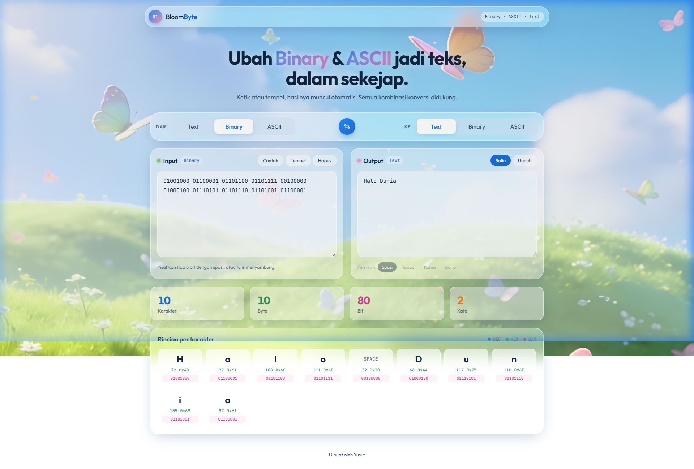

# Bloom Byte — Konverter Binary · ASCII · Text

Aplikasi web konversi instan **Binary · ASCII · Text** .

🔗 **Demo Live:** [https://ophari.github.io/bloom-byte/](https://ophari.github.io/bloom-byte/)

---

## 📸 Tampilan Web



---

## Fitur Utama

- **Konversi Multi-Arah:** Mendukung konversi bolak-balik antara:
  - Text ⇄ Binary
  - Text ⇄ ASCII
  - Binary ⇄ ASCII
---

## Struktur File & Folder

```text
bloom-byte/
│
├── static/
│   ├── css/
│   │   └── style.css                    # Styling antarmuka (Glassmorphism, tata letak, tema gelap)
│   ├── img/
│   │   ├── bg_upscayl_5x_upscayl-standard-4x.png  # Gambar wallpaper latar belakang HD
│   │   └── preview.png                  # Screenshot tampilan aplikasi web
│   └── js/
│       ├── converter.js                 # Engine logika konversi (Binary, ASCII, Text, decoding & breakdown)
│       └── app.js                       # Logika interaksi UI (event handler, render statistik & clipboard)
│
├── .gitignore                           # Berkas konfigurasi yang diabaikan oleh Git
├── index.html                           # Halaman utama web (HTML5)
└── README.md                            # Dokumentasi resmi proyek
```
